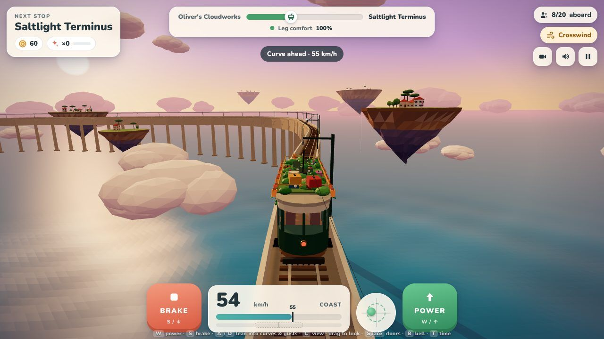
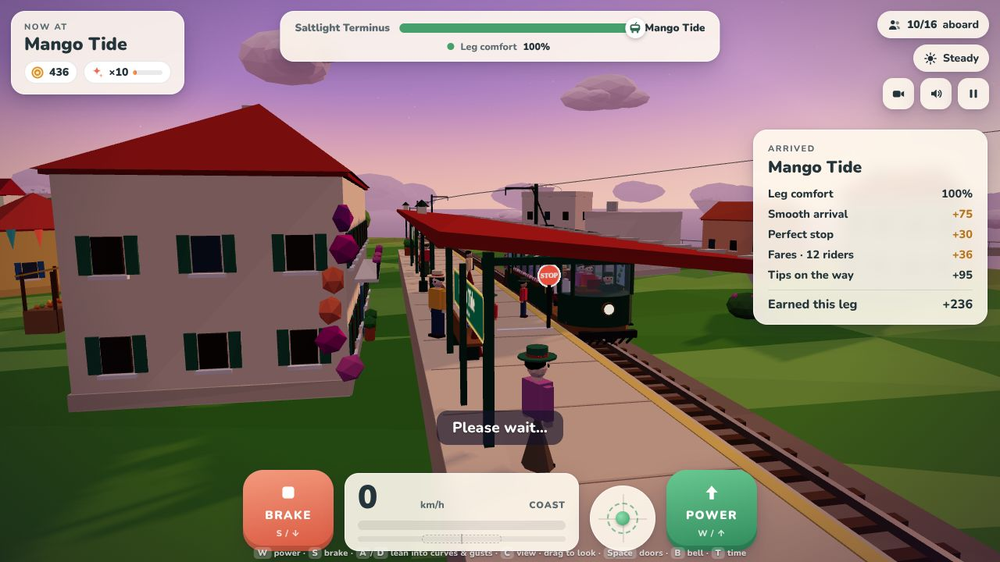
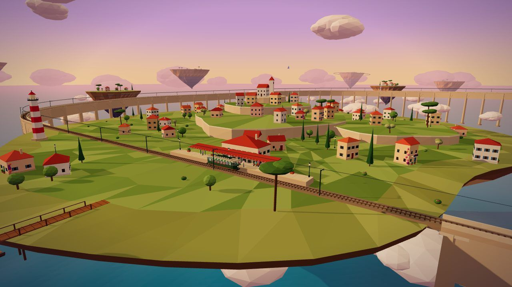
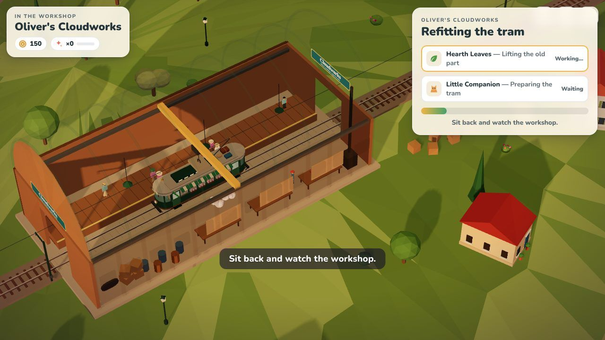
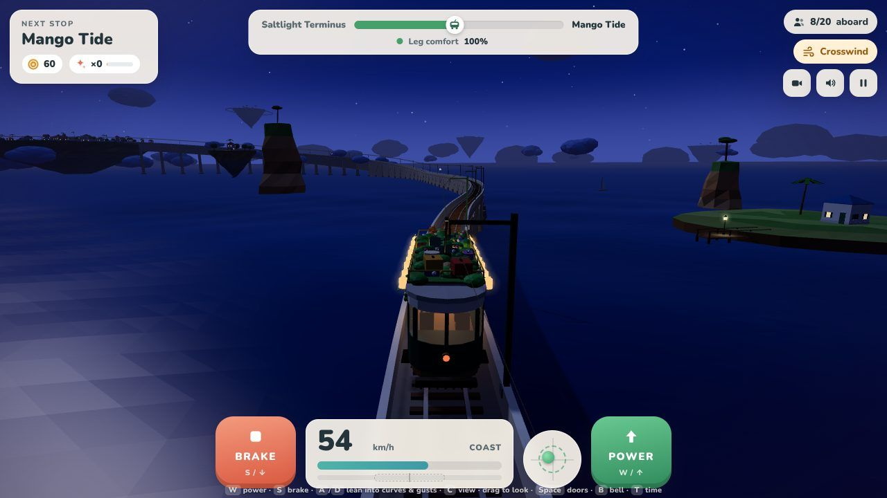

# SkyTram · The Coastal Line

A cozy, low-poly 3D driving game for the browser, built with [Three.js](https://threejs.org/).
You drive a retro aerial tram between floating seaside islands, high above a sea of clouds and an
azure ocean. Ease the power on, brake gently, lean into the curves and the crosswinds, and get your
passengers to the next platform without spilling their tea.

**Play it:** once GitHub Pages is enabled (see below), the game lives at
`https://swissmarley.github.io/SkyTram/`. You can also just open `index.html` in a browser.
It's a single file, with no build step and nothing to install (it needs an internet connection
to load Three.js and the font from a CDN).

## How to play

| Keyboard | Touch | What it does |
| --- | --- | --- |
| `W` / `↑` | hold **POWER** | Apply power. It builds up gradually, so feather it. Too much at once jolts the passengers. |
| `S` / `↓` | hold **BRAKE** | Brake. Hard braking is uncomfortable; start slowing down early. |
| `A` `D` / `←` `→` | **◀ ▶** | Lean the tram into curves and against crosswind gusts. |
| `C` · `Q` `E` (and `←` `→` while stopped) | camera button | Switch view: chase, driver's cab, trackside, high. |
| drag the 3D view | drag | Fine-tune the camera angle. It drifts back on its own. |
| `Space` / `Enter` | **Open doors** | Open the doors once you've stopped at a platform. |
| `B` · `M` · `P` · `T` | — | Ring the bell · mute · pause · skip ahead in time. |

**Comfort & tips.** The ball in the round gauge shows where the passengers are being pushed.
Keep it inside the dashed ring. Sudden acceleration, hard braking, taking corners too fast and
crosswinds all cost *leg comfort*. Every smooth stretch builds your streak and earns tips.
Drive too bumpily and you'll see *"Streak broken. Find your balance to rebuild your tips."*

**Stations.** Watch the *stop in … m* hint and the speed-advisory signs before curves. Stop with
the doors along the platform, then open them. The arrival card adds up your ride: a smooth
arrival (+75), a perfect stop (+30), fares and the tips you collected on the way.
Townsfolk queue on the platform, step off, climb aboard and fill the seats (12/16 aboard…).
If you come in too fast, the station's safety brake bites, and nobody likes that.

### The line

1. **Saltlight Terminus.** A hillside town with red-tiled roofs, a church tower, a lighthouse and a sky-boat dock.
2. Down through the clouds and across **the long sea bridge**, a low stone viaduct over the waves. Expect crosswinds.
3. Climb to **Mango Tide**: bright houses, palm and mango trees, a fruit market and bunting.
4. Wind through the high S-curves to **Oliver's Cloudworks** on Oliver's home island.
5. Back to Saltlight along **the Coastal Line**, past little floating islands.

The sky slowly turns from golden dusk through blue-purple twilight to a starry night and back.
At night the windows glow, the street lamps and the lighthouse beam come on, and the tram
lights up inside.

### Oliver's Cloudworks (the workshop)

At the Cloudworks the view switches to an isometric cut-away of Oliver's workshop. Spend your
tips on parts and watch the crane, Oliver and his little cloud-sprite helpers refit the tram:
*"Hearth Leaves — Lifting the old part"*, *"Little Companion — Preparing the tram"*.
Sit back and watch the workshop. Then it's *"All aboard."* and *"Next stop: the Coastal Line."*

| Part | Looks | Effect |
| --- | --- | --- |
| Hearth Leaves | living green roof & trailing vines | crosswind gusts −30% |
| Little Companion | a ginger tabby riding on the roof | +1 tip every smooth stretch |
| Brass Roof Rack | brass rail & stacked suitcases | capacity 16 → 20 passengers |
| Paper Lanterns | glowing lanterns along the roof | +50% tips after dark |
| Soft Springs | brass coil springs on the bogies | comfort drains 25% slower |

## Deploying to GitHub Pages

The workflow in [`.github/workflows/deploy-pages.yml`](.github/workflows/deploy-pages.yml)
publishes the game on every push to `main`, and you can also run it by hand from the Actions tab.
It syntax-checks the game script first, then uploads `index.html` (plus `docs/`) as the site.

One-time setup: **Settings → Pages → Build and deployment → Source: GitHub Actions.**

## Running locally

Open `index.html` directly, or serve the folder with any static server, for example
`npx serve .` or `python3 -m http.server`, and open the printed URL.

Handy URL parameters for poking around:

| Parameter | Example | Effect |
| --- | --- | --- |
| `quality` | `?quality=low` | Low quality: no shadows and fewer clouds. This is the default on touch devices. |
| `time` | `?time=1` | Time of day: `0` dusk … `0.5` twilight … `1` night. |
| `autostart` | `?autostart=1` | Skip the title screen. |
| `s`, `v` | `?s=950&v=15` | Start driving at that distance along the line (m) and speed (m/s). |
| `cam` | `?cam=cab` | Start with `chase`, `cab`, `side` or `sky` view. |
| `workshop` | `?workshop=1` | Jump straight into Oliver's workshop. |

A small debug handle is exposed as `window.skytram` in the browser console.

## How it's built

Everything is in `index.html`: the HTML/CSS for the UI, plus one ES-module script that imports
Three.js `0.180.0` from jsDelivr through an import map. The script is split into numbered,
commented sections:

- **Track:** a closed `CatmullRomCurve3` (centripetal) through hand-laid control points (straights + arcs),
  resampled by arc length into ~1 m frames with tangent, curvature, grade and superelevation (bank).
  Rails, deck and parapets are swept along those frames. Sleepers, piers, arches and catenary poles are instanced.
- **Tram:** sits between its two bogies on the rails. The body rides a spring-damper suspension:
  it rolls with the felt lateral force, leans when you lean, pitches when braking and bounces at
  the rail joints (with a matching clickety-clack).
- **Physics:** a master controller with inertia (power ramps up, brakes bite progressively),
  power-limited traction, rolling and air resistance, gravity on the grades, a holding brake, and
  a station safety brake. Comfort uses the acceleration the passengers actually feel:
  `v²·κ` against the bank, plus wind and your lean.
- **World:** procedural floating islands (strata cliffs, terraces with stone retaining walls),
  Mediterranean houses, trees, lamps, a lighthouse, docks, a market and the workshop hangar.
  These are painted into a few big vertex-coloured meshes to keep draw calls low. Also: a
  shader-displaced flat-shaded ocean, instanced clouds, a gradient sky dome with sun, moon and
  stars, gulls, boats and distant islands circled by orbit rails.
- **Audio:** fully procedural WebAudio. Motor hum and whine, rail clacks, wind, brake squeal,
  sea swell, the tram bell, door chimes and a little music-box loop. No sound files.

## License

[MIT](LICENSE)
